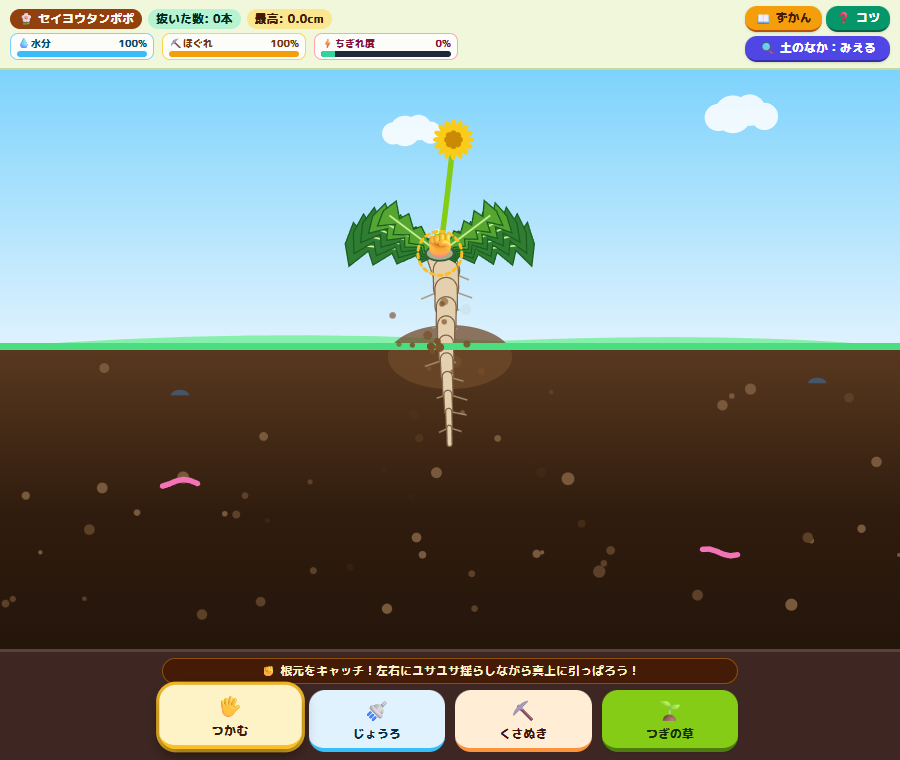
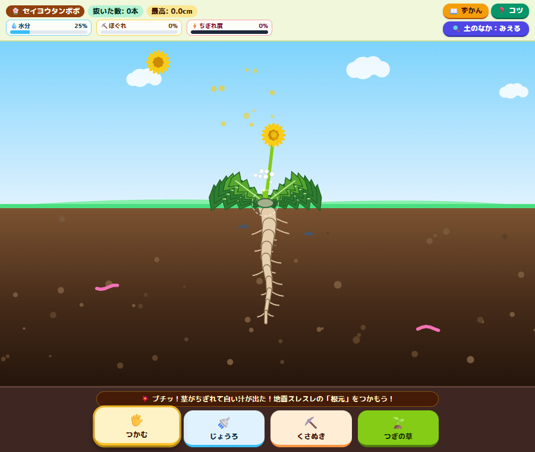
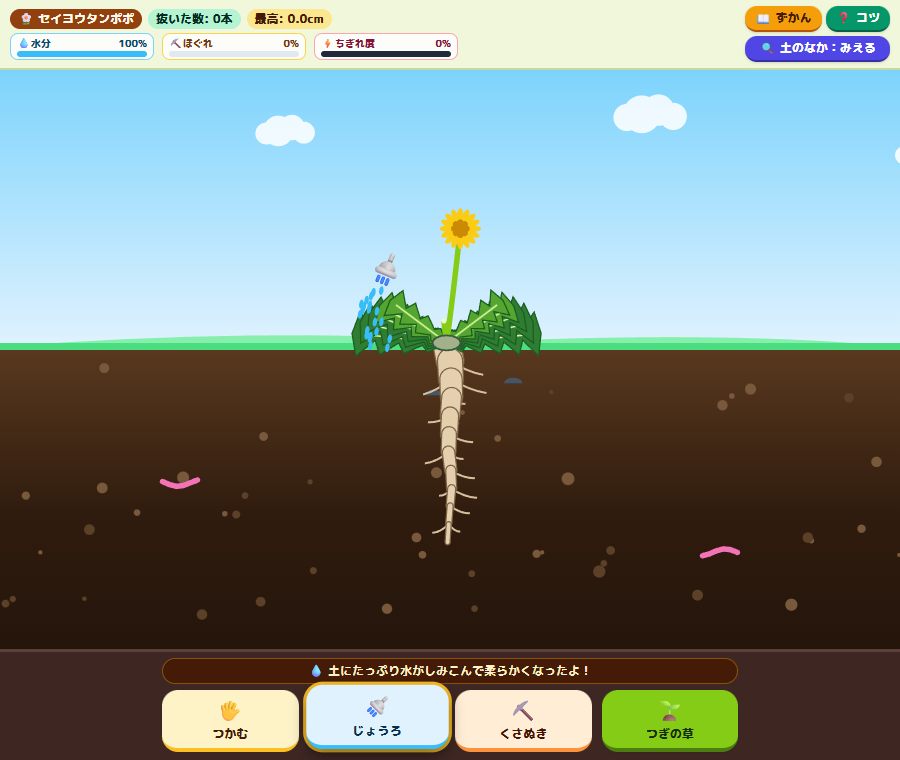
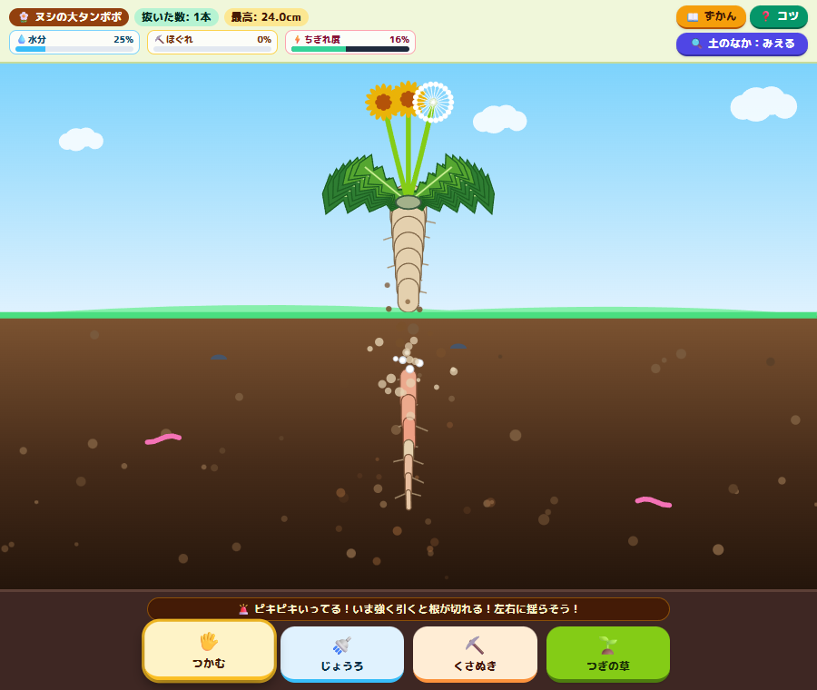
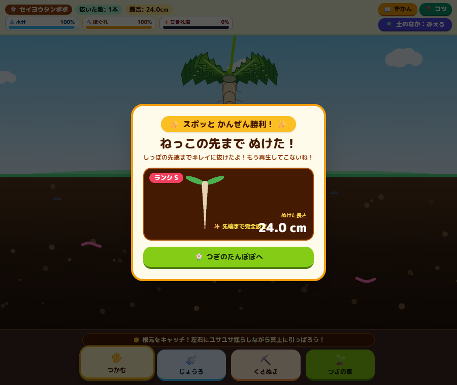
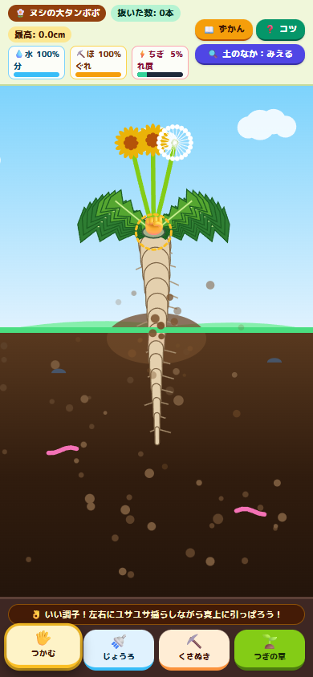
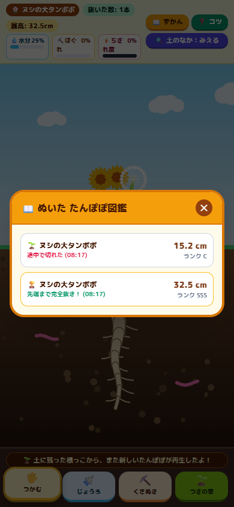

<h1 align="center">スポッと快感！リアルたんぽぽ抜きシミュレーター</h1>

<p align="center"><a href="README.md">English</a> | <b>日本語</b></p>

<p align="center">
  <b>根元をつかんで、左右にユサユサ揺らして、根っこの先までスポッと抜く。<br>
  土の断面ごと見える、バネでつながった主根と合成音でできた、ブラウザで遊べる1ファイルのおもちゃ。</b>
</p>

<p align="center">
  <a href="https://futurecortexlabs.github.io/FCTX-Dandelion-Play/"><b>▶ 遊んでみる</b></a>
  &nbsp;·&nbsp;
  <a href="#仕組み">仕組み</a>
  &nbsp;·&nbsp;
  <a href="#既知の限界">既知の限界</a>
</p>

<p align="center">
  
</p>

<p align="center">
  <sub>
  水をやって土をほぐしてから引き抜いている途中。根元はもう地上に出て、主根が抜けてきています。ヘッドレス Chrome で実際にマウス操作して遊んだときの画面です。
  </sub>
</p>

---

## これは何か

草むしりをしたことがあれば覚えがあるはずです。葉っぱを持って引っぱるとブチッとちぎれて、根が残り、また生えてくる。うまく抜けたときだけ、根っこが一本まるごとスルッと出てくる。

その一瞬だけを遊ぶおもちゃです。地面は断面で描いてあるので、土の中の主根と側根（ひげ根）を見ながら抜けます。画面の文字は日本語です。

| 操作 | 起きること |
|:--|:--|
| **花や葉っぱをつかむ** | 指のほうへしなり、ちぎれ度のゲージが上がる。引っぱりすぎるとブチッとちぎれて、切り口から白い汁（乳液）が出る |
| **じょうろで水をやる** | 水がしみこむと土の色が濃くなり、根をつかむ力が弱まる |
| **くさぬきで土をほぐす** | 根元のまわりをこすると土が盛り上がって、フカフカになる |
| **根元をつかんで揺らす** | 左右に揺らすと土がほぐれ、側根がプチプチと一本ずつ外れる |
| **真上に引っぱる** | 根のどこも限界を超えなければ、先端まで「スポッ！」と抜ける。斜めに引いたり急に引いたりすると途中で切れる |
| **抜いたあと** | 抜けた長さとランクが出る。根が切れたときは、残った根からまた生えてくるところを見られる |

新しい株は5種類からランダムに選ばれます。

| 品種 | 根の深さ | 土のつかみ | |
|:--|:--|:--|:--|
| セイヨウタンポポ | 72 % | 0.95 | 花が2本。揺らせば抜ける |
| カントウタンポポ | 66 % | 0.82 | 花が1本。いちばんやさしい |
| シロバナタンポポ | 76 % | 1.10 | 白い花びら。根が少し深く、水やりが効く |
| わたげタンポポ | 80 % | 1.15 | 綿毛。揺らすと種が飛び、強く引くと茎がちぎれる |
| ヌシの大タンポポ | 88 % | 1.45 | 茎が3本で、根がいちばん太い。じょうろとくさぬきが必須 |

根の深さは、地下の領域のうち主根が届く割合。土のつかみは、土が根を引き留める強さです。

<table>
<tr>
<td width="50%"></td>
<td width="50%"></td>
</tr>
<tr>
<td></td>
<td></td>
</tr>
<tr>
<td align="center"></td>
<td align="center"></td>
</tr>
</table>

---

## 遊び方

- **オンライン:** [futurecortexlabs.github.io/FCTX-Dandelion-Play](https://futurecortexlabs.github.io/FCTX-Dandelion-Play/)
- **ローカル:** `index.html` をブラウザで開くだけです。ビルドもローカルサーバーも要りません。ただし Tailwind CSS とフォントを読み込むため、インターネット接続が必要です。

音が出ます。最近のブラウザなら、PCでもスマホでも動きます。

| ボタン | PC | スマホ |
|:--|:--|:--|
| 🖐️ **つかむ** | 根元・花・葉っぱの上で押してドラッグ | タッチしてドラッグ |
| 🚿 **じょうろ** | マウスボタンを押している間、水が出て地面にしみこむ | 同じ |
| ⛏️ **くさぬき** | 株の根元のまわりをドラッグ | 同じ |
| 🌱 **つぎの草** | ランダムな新しい株に替える | 同じ |
| 🔍 **土のなか** | 断面を見せる／かくす | 同じ |
| 📖 **ずかん** | 最近の30回分の記録 | 同じ |
| ❓ **コツ** | 上手に抜くための3つのコツ | 同じ |

根元（クラウン）は、地面の高さにある点線の円の中の小さな円盤です。ミミズをタップするとクネクネ動き、ダンゴムシをタップすると丸くなります。

---

## 仕組み

すべて `index.html` 1ファイルに入っています。レイアウトは Tailwind CSS、プレイ領域は `<canvas>` 1枚、あとは素の JavaScript です。画像ファイルや音声ファイルは使っていません。

```
毎フレーム (requestAnimationFrame)
  |
  +- 入力        つかんでいる部位（根元・茎・葉）と、引っぱった距離
  +- 土          抵抗 = max(0.15, 1 - (0.42 x 水分 + 0.45 x ほぐれ))
  +- 根のチェーン 根元から下へバネでつないだノード、側根の離脱、ノードごとの張力、破断か引き抜きか
  +- 周辺        水滴、白い汁、土ぼこり、綿毛、雲、ミミズとダンゴムシ
  +- 描画        Canvas 2D: 空、土の断面、根、葉、花、重ね描き
```

ヘッダー、プレイ領域、ボタンバーは別々の行に分けてあるので、株の上に文字やボタンが重なることはありません。地面はプレイ領域の高さの48%の位置にあり、株はその上下に収まるように拡大縮小されます。

### 主根はバネのチェーン

主根は根元から下へ並んだ11〜16個のノードです。各ノードは親ノードとの自然長、先端へ向かって細くなる半径、`28 + 4.6 × 半径` の強さを持っています。土は各ノードを元の位置へ引き戻そうとします。その力は中ほどの深さで最も強く、品種の「土のつかみ」、土の抵抗、そのノードのまわりのほぐれ具合、まだ付いている側根の数（1本ごとに32%増し）で決まります。

根元が上へ動くと、各ノードは親ノードについていきます。土に強くつかまれているノードほど動きにくいので、その間のバネが伸びます。この伸びが張力になります。

```
張力 = 伸び x (1 + 1.08 x 土の引き留め) x 角度ペナルティ x 速度ペナルティ
```

- **角度ペナルティ:** 親ノードが地上に出たあと、横へ引くと張力が最大2.6倍になる。
- **速度ペナルティ:** ポインタを1フレームあたり14pxより速く動かすと、超えた1pxごとに5.5%増える。

どこかのノードで張力が1.0に達すると、根はそこで切れ、それより下は土に残ります。付いているノードがすべて地上に出たら、根は先端まで抜けたことになります。

### 側根と揺さぶり

側根は1本ずつ土に固定されています。ノードが固定点から `長さ + 12 × 土の抵抗 + 5` より遠くへ動くと、「プチッ」と外れます。根元を左右に揺らすと2つのことが起きます。土全体がほぐれ、さらにノード同士の横のずれで各ノードのまわりの土もほぐれます。だから引き上げる前に側根が外れていきます。

### 茎と葉

花や葉っぱは、つかんだだけではちぎれません。68px（葉は65px）より遠くへ引っぱったときだけちぎれます。それまでは指のほうへしなり、離すとビヨーンと戻ります。ちぎれた茎は中が空洞の切り株を残し、切り口から白い汁が出ます。

### 結果と保存

抜けた長さ（cm）は、地上に出た根のピクセル長 × 0.12 です。先端まで抜けたときは、25cm以上で **SSS**、18cm以上で **S**、それ未満で **A**。途中で切れたときは、60%より多く抜けていれば **B**、そうでなければ **C** です。

抜いた数、最高記録、最近の30回分の記録は `localStorage`（キー `dandelion_sim_save_v2`）に保存されます。抜いた数は先端まで抜けたときだけ数えます。最高記録は途中で切れたときの長さも対象です。

### 音

Web Audio でその場で合成している音は7種類です。張力のきしみ（張力が上がるほど速く高くなる）、ブチッとちぎれる音、側根のプチッ、綿毛のフワッ、じょうろの水音、くさぬきのザクッ、そして先端まで抜けたときのスポッとハ長調のアルペジオ。ブラウザはユーザー操作のあとでないと音を出せないので、最初にタッチかクリックしたときから鳴り始めます。

---

## 検証

ヘッドレス Chrome で、DevTools プロトコル経由で実際のマウスイベントを送って確認しました。

- 900 × 760 で、茎をちぎれるまで引っぱり、水をやり、土をほぐしてから、セイヨウタンポポを揺らしながら引いて先端まで抜いた（24.0cm、ランクS）。乾いた土からヌシの大タンポポを真上に急いで引き、13.7cm（ランクC）で切れた。そのあと再生を見て、図鑑とコツを開いた。
- 同じ流れを 390 × 844 のスマホエミュレーションで。
- コンソールに出たのは、Tailwind の「CDN版は本番向けではない」という警告だけ。エラーはなし。

この README のスクリーンショットはその実行から撮ったものです。操作に使ったスクリプトはこのリポジトリに含まれておらず、自動テストもありません。上の確認はマウスイベントで行ったもので、実機のスマホでのタッチ操作はまだ試していません。

---

## パフォーマンス

| | |
|:--|:--|
| サイズ | `index.html` 1ファイル、約94KB |
| ネットワーク | Tailwind CSS の Play CDN と、Google Fonts の M PLUS Rounded 1c |
| フレームレート | 実機ではまだ測っていない |

---

## 既知の限界

- **日本語のみ。** 画面の文字はすべて日本語です。
- **ネット接続が必要。** 見た目は CDN から読み込む Tailwind のランタイムに頼っています。CDN が使えないと、スタイルがすべて外れ、結果のダイアログがボタンの下に出たままになります。
- **画面サイズが変わると株が替わる。** プレイ領域のサイズが変わるたびに、ランダムな新しい株が生えます。スマホを横に倒したときもそうです。スマホではアドレスバーが出たり引っ込んだりするだけで、引いている途中に替わるかもしれません。実機ではまだ確かめていません。
- **物理は1秒ごとではなく1フレームごとに進む。** 120Hz や 144Hz のディスプレイでは、すべてが速く進みます。
- **長さは画面に左右される。** 根はプレイ領域の高さに合わせて伸び縮みするので、端末が違うと記録を比べられません。
- **高解像度の画面に合わせていない。** キャンバスを devicePixelRatio に合わせて拡大していないので、Retina やたいていのスマホではぼやけて見えます。
- **指は1本だけ。** 最初のタッチだけを追っています。
- **幅の狭いスマホでは窮屈。** 幅 390px だと、ゲージのラベルが折り返します。
- **結果カードの文字が少し重なる。** 先端まで抜けたとき、「先端まで完全抜き！」の文字が長さの表示にかかります（上のスクリーンショットでも見えます）。

---

## リポジトリ

| パス | 中身 |
|:--|:--|
| [`index.html`](index.html) | ゲームのすべて: レイアウト、シミュレーション、描画、音、保存、文言 |
| [`docs/media/`](docs/media) | この README で使っているスクリーンショット |
| [`README.md`](README.md) | この README の英語版 |

Tailwind CSS（MIT ライセンス）と M PLUS Rounded 1c フォント（SIL Open Font License 1.1）は実行時に読み込んでいるもので、このリポジトリには含めていません。
